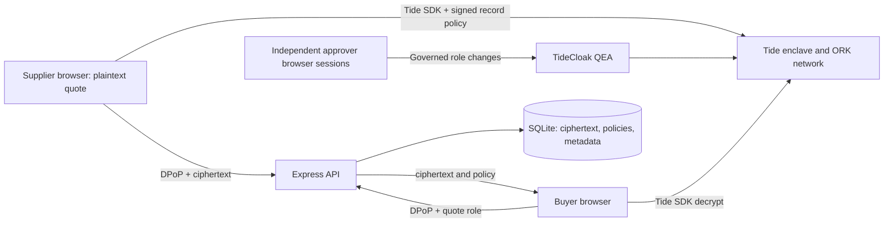

[](https://tide.org/)

# CoBid — Project overview

CoBid helps small businesses bid together while keeping confidential commercial quotes under separately governed access.

**Vision & originality.** A designer, a software studio, and a film studio assemble one university campaign proposal without appointing a lead company with automatic access to every commercial detail.

**Trust constraint insight.** Ordinary login and database permissions leave an administrator able to change the rules. CoBid connects encrypted quotes to Tide-governed identity roles, so the intended demonstration requires independent approval before a sensitive access grant takes effect.

**Value & impact.** Small studios can pursue larger opportunities while sharing public capabilities and limiting who can open their margins, subcontractor allowances, and confidential terms.

**Why TideCloak matters.** The browser uses Tide SDK encryption and signed record policies. The API checks signed tokens, sender-bound DPoP proofs, and per-quote roles. Tide's network must validate the policy and credential when protected operations run; application buttons and access-request records cannot authorize them.

**Prototype & storytelling.** The product includes a bidding room, structured quotes, buyer summary, access intent, and activity. An explicitly labeled local simulation now rehearses denied coordinator access, a pending solo self-grant, and a buyer grant approved by two different demo administrators. Real Tide authentication, encryption and network governance remain unverified. See [verification](docs/verification.md).

## Run the local simulation

```powershell
npm ci
npm run simulate
```

Open **http://localhost:5173** and choose a demo identity. No Docker, license or real Tide account is needed. The seven fictional identities, three seeded quotes, access checks and two-admin approvals run locally. The UI continuously labels simulation mode; quote contents are base64-encoded synthetic JSON, **not encrypted**.

Use **Access requests** to rehearse the workflow, or **Connection & setup** for the guide. [Simulation and planned Tide integration](docs/simulation.md) documents the boundaries and exact steps.

## Run with real TideCloak

Requires Node **22.13+** (Node 24 recommended), npm, and internet access to Tide. Live identity and cryptography require Docker Desktop with **Linux containers**, a licensed QEA-enabled realm, and human-owned Tide accounts. An existing TideCloak server can replace local Docker.

```powershell
npm ci
npm run setup
npm run tide:up
```

Set `AUTH_MODE=tide` in `.env`. Complete [TideCloak setup](docs/tidecloak-setup.md), export the **public** `tidecloak.json` adapter into the repository root, then:

```powershell
npm run dev
```

Open **http://localhost:5173**. Vite runs on port 5173 and proxies `/api` to Express on 3001. Without a realm adapter, the public workspace is available and protected operations remain disabled. Live mode has no simulated login or approval fallback. Simulation is an explicit separate mode.

To serve a production build locally:

```powershell
npm run build
```

Set `APP_ORIGIN=http://localhost:3001` in the ignored `.env`, register that origin and `http://localhost:3001/auth/redirect` in TideCloak through governance, then run `npm start` and open http://localhost:3001. Restore the development origin before using `npm run dev` again. Tokens, redirect URIs and DPoP proofs must agree on the public origin.

## Configuration

`npm run setup` creates an ignored `.env` with a random bootstrap password and preserves existing configuration. Read bootstrap credentials locally; never paste them into a recording, issue, or chat.

| Variable | Purpose |
|---|---|
| `AUTH_MODE` | `tide` (default) or explicit local `simulation`; `npm run simulate` selects the latter |
| `APP_ORIGIN` | Browser origin used for redirects, origin checks and DPoP URL binding |
| `HOST`, `PORT` | Express binding; defaults `127.0.0.1:3001` |
| `TIDECLOAK_URL`, `TIDECLOAK_REALM` | Identity server URL and realm |
| `TIDECLOAK_CLIENT_ID`, `TIDECLOAK_AUDIENCE` | Public OIDC client and required access-token audience |
| `TIDECLOAK_ADAPTER_PATH` | Exported public adapter; defaults `./tidecloak.json` |
| `DATABASE_PATH` | Live-mode SQLite store; defaults `./.local/cobid.sqlite`. Simulation always uses the separate `.local/cobid-simulation.sqlite` |
| `KC_BOOTSTRAP_ADMIN_USERNAME`, `KC_BOOTSTRAP_ADMIN_PASSWORD` | Local TideCloak bootstrap only; never supplied to browser code |
| `TIDECLOAK_IMAGE` | Development image; record its resolved digest during live verification |
| `TIDE_LICENSE_EMAIL`, `TIDE_TERMS_ACCEPTED` | Local operator consent record; enrollment uses the official wizard |

JWT verification trusts public Ed25519 keys in the operator-installed adapter, not a key retrieved from the application database. `.env`, adapters, dependencies, local database/backups, and build output are excluded from Git.

## Identities and roles

Use the [role matrix](docs/tidecloak-setup.md#demo-identities-and-role-matrix) to enroll three studios, a buyer, and three governance administrators. One administrator also plays the bid coordinator. Keep business membership separate from governance roles. Each approver uses a separate authenticated browser profile and their own Tide account; Live mode has no identity-switching control. Only simulation offers a labeled demo identity picker.

There are no committed demo passwords. For real shared quote cryptography, a licensed network supporting **`RelationshipAttestation:1`** is required for this cross-user quote flow. Do not replace it with a self-only encryption example and claim shared quote access.

## Architecture and boundaries

The following describes real Tide mode. Simulation replaces these boundaries with local application logic as documented in [simulation.md](docs/simulation.md).



Plaintext exists in the contributor's form and an authorized recipient's browser. TideCloak governs identity/role changes; the Tide network validates cryptographic operations. Express protects API operations and SQLite handles persistence, replay tracking and optimistic updates. A quote-role member needs `_tide_decryptor` and an applicable signed policy to decrypt. Coordination and administration confer no automatic quote access.

The app host controls frontend delivery and availability. A malicious delivered frontend can steal plaintext from a user who opens it. Database logs are editable application history. Authorized recipients can copy what they see. Role removal affects future sessions/operations after claims refresh or expire; it cannot recall existing copies. The master-realm recovery path and colluding quorum remain trust boundaries. See [architecture](docs/architecture.md).

## Checks and demo

```powershell
npm run check
npm run doctor
```

`check` runs JavaScript syntax checks, TypeScript, offline behavior tests, and the production build. Tests generate their own signing keys and synthetic policy fixtures; they do **not** establish real Tide authentication, decryption or quorum behavior. `doctor` performs read-only prerequisite checks without printing tokens or passwords. Live results are tracked in [docs/verification.md](docs/verification.md).

Use [DEMO.md](DEMO.md) for timed narration, exact identities/actions, rehearsal and reset. To reset application data, stop CoBid and run:

```powershell
npm run demo:reset -- --confirm
```

The reset backs up the database, preserves signed policies and DPoP replay history, and clears quotes, access intent and activity. `--policies` additionally removes quote policies. In simulation mode it targets the simulation database and clears simulated grants/approvals too; restarting restores synthetic seed quotes. It never resets real Tide users, roles, approvals or existing plaintext copies; those require a separate governed reset in TideCloak.

## Submission status

The repository contains application code and the operational/demo guides. A real two-minute MP4 under 100 MB must be added at `demo/CoBid-demo.mp4` after the live acceptance flow passes. No placeholder video is provided. Do not present setup screens or local signing fixtures as the live governance demonstration. Repository visibility and hackathon submission are operator actions.
