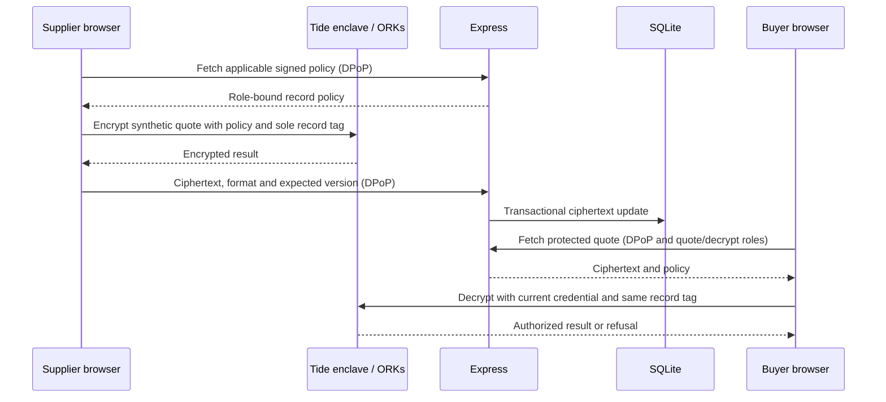

# CoBid architecture and trust boundaries

The app now supports an explicitly requested **local simulation** as well as the existing real Tide path. The technical descriptions below refer to `AUTH_MODE=tide` unless stated otherwise. See [simulation.md](simulation.md) for the MCP-informed mapping, fictional identities, mock sessions/approvals, separate database and unencrypted quote encoding. Simulation never establishes the real guarantees described here.

## Application

The existing React 19/TypeScript/Vite frontend contains the public bidding room, protected structured quotes, access intent, buyer proposal/download, application activity and connection setup. A single fixed room and three synthetic contributors are defined in `shared/catalog.mjs`. Navigation is local component state; this prototype has no general procurement, payment, upload or multi-room system.

Express 5 uses Helmet and strict Zod request validation. Public configuration and brief endpoints are available before sign-in. Every protected API operation verifies the session before checking business membership and per-operation roles. It serves `dist` for a single-origin build; development Vite proxies `/api` to Express.

Node's built-in SQLite stores ciphertext, policy bytes, request metadata, activity metadata and DPoP proof identifiers. Quote updates use a transaction and an expected version to reject stale writes. Application access requests are deduplicated by supplier/recipient; they do not change permissions.

## Identity and request authentication

The operator exports a **public** TideCloak adapter into ignored local configuration. `server/config.mjs` checks the realm, public client and server, rejects credentials/private keys, and allowlists fields sent to the browser. It forces strict DPoP and a callback matching the configured public origin.

The backend validates EdDSA JWTs against the adapter's pinned public Ed25519 JWK set, exact issuer, required audience, authorized party and required identity/time claims. It accepts only the DPoP authorization scheme and verifies the proof's key thumbprint, token hash, HTTP method, public request URL, timestamp and unique identifier. SQLite rejects replayed identifiers for the proof validity window. This proof binds the request, not the business approval itself.

Business roles come from `realm_access.roles`. Governance administration can also arrive as `resource_access['realm-management'].roles`; roles from an arbitrary client never confer it. An admin can inspect configuration/policy setup without business membership, but reading a quote still needs its quote role and `_tide_decryptor`.

## Protected quotes

`src/lib/tide.ts` calls real `IAMService.doEncrypt/doDecrypt`; there is no local encryption or mock-auth fallback. It names `RelationshipAttestation:1`, the realm vendor ID, a realm role subject and exactly one fixed quote record ID. Policy parameters authorize encryption/decryption models. The actor must also have the relevant global crypto realm role. The buyer receives decryption only; the API additionally prevents supplier writes without the matching business role.

An enrolled governance admin signs policy bytes in their browser using Tide's referenced `PolicySignRequest` flow. The SDK's `_tc` signing seam is currently internal and version sensitive; this follows the pinned Tide MCP helper and requires a live check. The API parses the policy and checks expected contract, vendor, subject, operations, record and signature shape. It **does not cryptographically establish the policy's network validity**. The network validates it when used. A policy cannot be replaced after its quote is sealed.

Plaintext is held in the form/authorized view in browser memory. The app does not send structured plaintext quotes to its API or store them in browser local storage. A session guard discards pending decryption/results when the identity or permissions change, the user signs out, refreshes access or closes the view. Clearing references is not a claim of forensic erasure from browser/process memory.

## Governed access changes

Application intent names the requesting subject, target supplier, required role and reason. Admins make the actual role change in TideCloak, inspect it in QEA Approvals and authorize it under independent browser sessions. CoBid shows intent and whether the **current caller's token** carries the role; it does not mirror unobserved approvals or rejection.

The documented admin threshold is `max(1, floor(0.7 * N))`. Three active admins are required for a two-approval demo. A quorum is not unanimous consent and does not give a supplier an individual veto. `APPROVED` in the current Tide QEA API means committed/applied; merely proposing a change or recording one vote is insufficient below threshold. Use the actual console count/status as evidence.

The admin-only role-members view reads the standard Keycloak-compatible directory through the **logged-in admin's browser**. It lists returned quote-role members and their effective decrypt-role mapping, with a snapshot warning and a link for inherited access. It cannot prove a live decrypt or guarantee old issued tokens have disappeared. Ordinary members are not given user-directory privileges just to render a roster.

## Residual trust and limits

| Component/actor | Enforces or can do | Limits |
|---|---|---|
| Tide network and licensed QEA | Validate supported cryptographic requests and governed credentials/changes | Must confirm actual contract support and real multi-admin setup; local tests do not prove this |
| Express | Verify tokens/DPoP; protect ciphertext and policy operations | A compromised server can disclose ciphertext/metadata, edit/drop stored rows or deny service |
| Database | Persist ciphertext/version/replay/activity | Not immutable or tamper proof; no plaintext cryptographic validity check |
| App host/frontend delivery | Controls code that users execute and service availability | Malicious code can steal input or decrypted content from authorized browser sessions |
| Governed admins | Propose and approve role/policy changes | A colluding valid quorum may grant access; business fairness is not guaranteed |
| Master-realm operator/recovery | Hosts and recovers realm administration | The official guide identifies master as outside QEA; do not claim absolute prevention of every platform-level override |
| Authorized recipient | Can open permitted plaintext | Can copy/screenshare/download it; future revocation cannot recall copies |

Real Tide authentication, crypto, multi-person governance and token refresh require real browser sessions. Offline live-path tests use test-generated signing keys and unsigned-in-the-network structural policy fixtures. They are never used in the live runtime. Live mode has no universal decrypt key, client-secret login, identity switch or service-account approval proxy. The separately enabled local simulator has selectable fictional identities and software-enforced permissions, with no Tide cryptographic protection.

Known prototype limits: fixed room/record IDs, no attachments, app intent is not synchronized to QEA outcomes, directory snapshot limitations, old-token revocation latency, no formal CSP because licensed network origins need verification, an unpinned dev container image, and unverified live policy signing/encryption until the acceptance checklist is completed.
